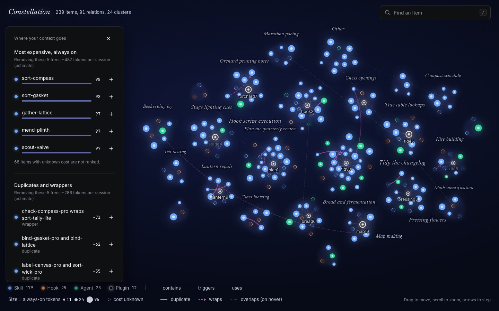

# Constellation

See your whole Claude Code setup as a map: what loads every session, what you never use, what overlaps.



*Invented demo data. No real setup appears anywhere in this repository.*

## Quick start

Python 3.13 is needed; `uv` fetches it for you.

```sh
# Once published on PyPI:
uv tool install constellation-cli        # or: pipx install constellation-cli
# optional, better groups (adds the local model, about 100 MB): uv tool install constellation-cli --with fastembed
#   or pipx inject constellation-cli fastembed; from install.sh: sh install.sh --better-clustering

# Until then, straight from GitHub:
uv tool install git+https://github.com/esharif20/constellation

constellation open demo                  # try it on invented data first
constellation scan                       # reads ~/.claude, no key needed (offline), shows progress
constellation open                       # your own map: opens the latest scan
```

Or run the small installer (no sudo; it only drives uv or pipx and prints what it does). Read it first, it is short:

```sh
sh install.sh --dry-run    # show what it would do
sh install.sh
```

The package is not on PyPI yet, so the PyPI lines above start working once it is published.

## Commands

Run `constellation --help` for the full list. The main ones:

| Command | What it does |
|---|---|
| *(no command)* | A menu: Scan, Open, Analyze, Find, Clean, Status, More. Esc goes back, Q quits |
| `scan` | Read a Claude Code config directory and write a scan file (bare `scan` needs no path) |
| `open` | Serve a scan as a graph in the browser (`open demo` for sample data) |
| `status` | One screen: session-start cost, verdicts, this week |
| `find <words>` | Find an installed skill by what it does; `--kind`, `--forgotten`, `--origin` filters |
| `doctor` | One-screen health check of your setup |
| `cost` | What loads at session start, biggest first |
| `unused` / `purge` | Items not used lately; Items only used by idle projects |
| `twins` / `clashes` | Overlapping pairs; hook, name and trigger collisions |
| `why <item>` / `remove-preview <item>` | Why an Item has its verdict; what refers to it and what removing it would lose |
| `profile <project>` | Which global Items one project really uses |
| `advise <folder>` | Which of your Items fit a project, plus a draft CLAUDE.md (`--write` never overwrites) |
| `expand <server>` | List the tools of one configured local MCP server |
| `clean` | Write a removal checklist (it never edits your setup) |
| `weekly` | What changed since the last scan, what went quiet |
| `share` | Write a public, redacted Snapshot |
| `update` / `uninstall` / `completion` | Print the upgrade command; remove the cache after a typed confirmation; shell completion |

Add `--dry-run` where it is offered to see what would happen without doing it.

## Privacy

- Your config files are read on your machine. File bodies and transcript text are never sent anywhere.
- At most, Item kinds, names and descriptions (plus short local signals) go to a model provider, after secrets and
  paths are redacted, and only if you give an API key. With no key, or with `--offline`, nothing is sent.
- The one exception is opt-in: `constellation scan --count-bodies` sends each skill's redacted body to Anthropic's
  token-counting endpoint to measure its cost when used. Without the flag that cost is shown as unknown.
- Redaction only matches secret values of 8 or more characters, so short PINs and passwords are not masked wherever they appear (a deliberate choice: shorter values also match ordinary words). Expansion tool text follows the same rule.
- No telemetry. Constellation never edits your Claude setup.

## Free by default

Hashing, wrapper checks, embeddings and clustering all run locally and cost nothing. A paid call happens only for a
new or changed Item, and its answer is cached by the content hash of the redacted text, so scanning an unchanged setup
makes zero paid calls. Every real run prints a call count and cost estimate first.

## How good is it

The Overlap pipeline is scored against 20 hand-labelled pairs (5 each of duplicate, wrapper, overlap, distinct) in
`tests/eval/overlap_pairs.py`. **The pairs are invented, not taken from a real setup, so this is a regression guard and
not proof of accuracy on yours.**

| Stage | Precision | Recall | How measured |
|---|---|---|---|
| Free local candidate band (word overlap, headings, mentions; flags pairs scoring 0.30 or more) | 0.83 (15 of 18 flagged) | 1.00 (15 of 15) | run 2026-11-06, no model, no network |
| Stronger-model verifier | not recorded | not recorded | needs an Anthropic key and about $0.20; run `uv run pytest -m eval -s tests/eval/test_overlap_quality.py` (guard: precision 0.8, recall 0.7) |

The local band never decides anything: it only keeps every labelled non-distinct pair in front of the verifier while
skipping some distinct ones. The scoring code itself is covered by the fast tests with a fake verifier.

## Status

Working and tested: the scan, the graph app (Inspector, Brief, Ask, lenses, verdicts, Find, safe-removal preview,
Expansion), the terminal menu and commands above, redaction of the whole saved scan, and the public Snapshot (with
pre-run Expansions and canned Ask answers). Backend logic that touches privacy or parsing is mutation-tested
function by function; frontend and terminal rendering are covered by exact-output, browser and pseudo-terminal tests.
See `docs/plan-tracker.md` for the per-ticket detail, including exactly what was and was not mutation-checked.

Not done or not verified:

- **Not on PyPI yet.** Install from GitHub for now (`docs/release.md` has the publish steps).
- **Real-data checks** (cluster names, verdicts, Find, MCP counts on a real setup) are the owner's to eyeball; the repo only ever holds invented data.
- **Touch devices** and the **real local embedding model** across many setups are not tested; the phone layout was checked in a desktop browser only.
- **Deploying a public Snapshot (#14), the landing page (#15), and issues #27 and #28** are parked.
- **Overlap verifier accuracy** is recorded for the offline path only; the paid verifier score is not recorded.
- Rebuild the UI with `cd frontend && npm run build` after pulling, or the browser shows an older bundle.

Safety note: a bare `scan` or `open` uses `./constellation.json` only if it is your own file with mode 600; otherwise it
is ignored with a one-line note (`chmod 600` it to use it), so a file from a cloned repo is never trusted as your scan.

The short version of how it works and what went wrong along the way: [`docs/overview.md`](docs/overview.md).

## Reference

Details below are for contributors and for the deeper features (report, snapshot, plugin, review).

See `GLOSSARY.md` for the vocabulary and `docs/adr/` for the decisions.

## Development

```
uv sync
uv run pytest                      # tests
uv run ruff check . && uv run ruff format --check . && uv run mypy
uv run mutmut run && uv run mutmut results   # mutation tests for the redaction guard; no output means no survivors
```

Tests never read a real Claude config: they use `tests/fixtures/` or a temporary directory.

### Graph app (frontend)

Vite, React, TypeScript, Tailwind and shadcn/ui in `frontend/`; the graph is `react-force-graph-2d`. Node 22 or newer.

```
npm --prefix frontend install
npm --prefix frontend run build    # typechecks, then writes the app to src/constellation/static/ (gitignored)
npm --prefix frontend run lint
```

`constellation open` serves that build and exits with a hint if it is missing. For live editing, run the API and the
Vite dev server side by side; the dev server proxies `/api` to port 8765 (or `CONSTELLATION_PORT`):

```
uv run constellation open docs/design/demo.json --no-browser   # invented demo data, safe to screenshot
npm --prefix frontend run dev
```

Design language and the refinement checklist: `docs/design/graph-app.md`.

Open **Ask** to search the saved scan, explain a selected Item, compare Context costs, or find known duplicates and never-seen Items. Submit a question to highlight matches on the map. Answers are short, cached in memory and free; models stay off, and no model download or API key is needed. Questions work only on the local server, not a published static page. Optional on-device generation is deferred, targeting a 16GB memory baseline.

## Using it

```
uv sync --extra llm --extra local              # the model and the local embedder are optional extras
constellation scan ~/.claude --dry-run > prompts.txt   # read-only; prints exactly what would be sent, sends nothing
constellation scan                             # ~/.claude, offline without a key; writes ~/.cache/constellation/scan.json (or ./constellation.json if present); -q quiet, -v verbose
constellation scan ~/.claude --out my.json     # explicit folder and file (mode 0600, descriptions redacted)
constellation scan ~/.claude --offline         # no paid or network calls: no labels or verifier, cached token costs only
constellation scan ~/.claude --no-verify       # skip the stronger model that labels candidate Overlaps
constellation scan ~/.claude --no-origins      # do not work out where Items came from (no skills lockfile is opened)
constellation preview ./pack --against constellation.json   # what a downloaded plugin or skill folder would add; nothing run or sent
constellation delta before.json after.json     # Items, always-on tokens and new Overlaps between two saved scans
uv run --extra local pytest -m eval -s         # slow clustering quality check with the real embedder
uv run pytest -m eval -s tests/eval/test_overlap_quality.py   # scores the Overlap verifier on 20 invented pairs (real model, a few cents)
```

`preview` reads a folder you downloaded yourself (run `git clone` first; Constellation never fetches anything), refuses symlinks that leave
it and special files, and never runs a hook or MCP server. Overlap is by same name; add `--meaning` to also compare by meaning with the local
embedder, which may download its model once from the network (it says so first). `preview` and `delta` call no provider and read no `.env`.

## Terminal commands

Read-only, local and free: each reads a saved scan (default: `./constellation.json` if present, else the latest scan) and uses the same engine as the app, so the terminal and the map cannot disagree. No provider call, no network. Add `--json` for structured output; colour only on a terminal and never with `NO_COLOR`. A mistyped command suggests the closest; exit code 2 means a usage error or a missing scan.

```
constellation doctor                      # session-start tokens and % of a 200k window, what could be reclaimed, top findings, hooks, MCP
constellation cost                        # the session-start bill, biggest first, then by plugin
constellation unused                      # Items not used lately, with confidence and how much history there is
constellation twins                       # overlapping pairs and which one you use
constellation why review-diff             # why this Item has its verdict, what removing it frees, what refers to it
constellation hooks                       # every hook by phase and weight
constellation clashes                     # hook, MCP name and trigger-phrase collisions
constellation triggers                    # skills that never fire or fire too greedily
constellation explain                     # plain-English summary of the whole setup
constellation ask "what costs the most?"  # the panel's local Ask (rules, no model)
constellation clean --out cleanup.md      # write the removal checklist; never edits settings
constellation share --out my-share        # the public Snapshot, same as `export --public`
```

`--habits FILE` points the verdicts at another habit ledger. Inside Claude Code, `/constellation:doctor` runs `constellation doctor`.

Overlaps: identical instructions and thin wrappers are found locally, embeddings propose similar pairs, and Claude Sonnet 5.5 labels each pair
from names, descriptions and a few local signals only. File bodies never leave your machine. A real run prints a pair-count and cost estimate
first; verdicts are cached in `~/.cache/constellation/overlap-verdicts.json`.

Caches (each a private 0600 JSON file keyed by the hash of the redacted text, with the model id mixed in for labels and verdicts, so a new
prompt, a changed Item or a new model is asked again and nothing else is): `labels.json` (labels), `overlap-verdicts.json` and
`token-counts.json`, all under `~/.cache/constellation/`. Delete a file to start it over. A re-scan of an unchanged setup makes zero paid calls;
adding two skills costs two label calls plus any new candidate pairs. An unwritable cache is a warning, not a crash.

Offline: `--offline`, or simply no `ANTHROPIC_API_KEY`, makes no paid or network calls. You still get Items, Relations, exact-duplicate and
wrapper Overlaps, token costs already in the cache (others show as unknown), and clusters grouped by words alone when the local
embedder is not installed (the scan warns "words only"; install fastembed for better groups). Labels are empty and the file's warnings say the run was offline.
`--offline` cannot be combined with `--count-bodies`, which sends text to Anthropic.

### Files Constellation reads

Everything is read locally. "Taken" is all that leaves the file; the rest is parsed in memory and forgotten. Nothing here is ever edited.

| File | Taken from it | Leaves the machine? |
| --- | --- | --- |
| `<config>/skills/*/SKILL.md`, `skills/synced/*/*/SKILL.md`, `agents/*.md`, `commands/*.md` | name, description (commands: first line), and an optional `repository` / `repo` line for the origin. The body is kept in memory only for local checks | Name and description, redacted, to the model. Bodies only with `--count-bodies` |
| `<config>/settings.json` and plugin `hooks/hooks.json` | hook events, matchers and commands; `enabledPlugins`; `env` values (to redact them elsewhere) | Hook command text as a description, redacted |
| `<config>/.mcp.json`, plugin `.mcp.json` and `plugin.json` MCP entries | each server's name, transport and command basename or URL host (never args, env, headers, paths) | The shape string, redacted |
| `<config>/plugins/installed_plugins.json`, `plugins/cache/*/*/*/.claude-plugin/plugin.json` | plugin install paths, name, description | Name and description, redacted |
| `~/.claude.json` (beside the config dir, or inside it) | the `mcpServers` of user and project scope, shape only. The file also holds OAuth tokens: nothing else is kept | The shape string, redacted |
| `<config>/.credentials.json`, `<config>/.env` | secret values only, so they can be scrubbed from everything else | No |
| `<config>/projects/**/*.jsonl` transcripts (skipped with `--no-usage`) | Item names matched to tool calls, counts and the date | No |
| `~/.agents/.skill-lock.json` (change with `--skill-lock`; skipped with `--no-origins`) | the `source` of each skill entry only, shortened to 60 safe characters. `sourceUrl`, hashes and dates are never read into anything | No: an origin is never sent to a model, never in a public export |
| a folder you pass to `preview` | names and descriptions of its skills, agents, commands, MCP entries and hooks, read only, nothing run | No |
| `.env` in the working directory | `ANTHROPIC_API_KEY` for the run | Only as the API credential |
| `~/.cache/constellation/*.json` (0600) | Constellation's own caches of labels, Overlap verdicts and token counts | No |
| `~/.cache/constellation/history.json` (0600, directory 0700) | **Written** by each real `scan` (not by `--dry-run` or `--no-history`): per scan day, the date, the Item and unknown-cost counts, the always-on token total, a hash of the config dir and the sorted 12-character hashes of Item ids. Never names, descriptions, labels, paths, origins, usage, warnings or file bodies (hashed ids keep names out of a long-lived file; they do not stop someone who guesses names). One entry per setup and day (a re-scan replaces it), entries more than 400 days older than the newest are dropped. `open --history FILE` reads another file; delete the file to start over | No |

Origins: a plugin's contents show the plugin name, skills synced from claude.ai show `claude.ai`, and a user skill takes the lockfile `source`, else
the folder name of the installer it is symlinked from (for example `agents`), else a `repository` line in its own frontmatter. The scan prints
`read origin from <file> (source field only)` when it opens a lockfile.

### Expansion

```
constellation expand claude-code:mcp_server:example --config-dir /path/to/config --file constellation.json
constellation open constellation.json --config-dir /path/to/config
```

Use the exact MCP server Item id from the saved scan. Expansion starts that selected configured local server, initializes MCP and lists
all pages of tools; it never invokes a tool or calls a model. The CLI prints JSON with tool Items and contains Relations. An unreachable
server returns an `unreachable` result with exit 0; an unknown Item or invalid input exits 2. Hosted connectors remain single Items.
The optional root on `open` enables the localhost-only `POST /api/expand` API (`{"id":"<known Item id>"}`); viewing without it remains
read-only. App presentation is a separate frontend integration.

Connection settings stay in memory, and Expansion never updates the saved scan or your setup. Tool names/descriptions are redacted;
schemas, server instructions and diagnostics are discarded. Initialization and all tool-list pages share a ten-second deadline, followed
by bounded SDK subprocess cleanup. Discovery is capped at 100 pages, 1,000 tools and 4,096 UTF-8 bytes per name/description;
excessive results return unreachable without partial tools. Redaction runs off the API event loop under the same deadline.
Only one Expansion per config root/server id runs at once; a concurrent duplicate returns unreachable without another launch.
Known secrets are read locally from the selected config only for redaction, never added to launch settings.
Explicit environment and argument values (including header and URL credential components) are also redacted from tool text; this may hide ordinary matching words.
The launch environment uses a temporary private HOME,
`PATH=/usr/bin:/bin`, `SHELL=/bin/sh`, `TERM=dumb` and `USER=LOGNAME=constellation`, then overlays only the registration's explicit env.
Executable lookup uses that PATH; cwd is the registration's config/plugin root. For binaries installed elsewhere (such as Homebrew `npx` or
user-installed `uvx`), configure an absolute command or an explicit PATH in that registration; a bare `npx`/`uvx` absent from the
fixed PATH returns unreachable. Private HOME also means ambient user
configuration and package caches are unavailable unless HOME is explicitly configured. Variable and plugin-placeholder substitution is unsupported
and returns unreachable. A configured command may itself contact external services or download packages; it runs with your local permissions.

### Report

```
constellation report                  # reads constellation.json; no network, no API key, no cost
constellation report scan.json --top 5 --all
constellation report --cleanup cleanup.md   # also writes a markdown checklist (new file only; --force overwrites)
```

Plain text, 80 columns, colour only on a terminal (and not when `NO_COLOR` is set). Items without a measured cost are counted as unknown,
never as 0. Descriptions and reasons pass through the same pattern redaction as the scan file; the file does not record your secrets, so
known-secret matching is not applied. `--cleanup` writes only that file (0600) and Constellation never edits your config.

```
Constellation report
  Items: 8 (agent 1, command 1, hook 1, mcp 1, skill 4)
  Relations: 1   Clusters: 2

Most expensive Items (always-on tokens) -----------------------------------
 1      420  ##########  deploy (skill)
      cluster deploy · purpose ships code to production
      Ship the current branch to production with the release checklist.
 2      415  ##########  ship (skill)
 3      180  ####        release-notes (skill)
  Total always-on: 1,210 tokens across 6 Items; 2 Items have unknown cost
  (not counted as 0).

Overlaps ------------------------------------------------------------------
  duplicate (1)
    deploy (skill) and ship (skill)
      The two have identical instructions under different names, so keeping
      both only costs tokens.
  wrapper (1)
    reviewer (agent) wraps review (skill)
```

(Abridged from `tests/fixtures/scan.json`; the full output is `tests/fixtures/report.txt`.)

### Public Snapshot

Build the frontend once, then export a saved scan to a **new** directory:

```sh
npm --prefix frontend ci
npm --prefix frontend run build
uv run --all-extras constellation export --public scan.json --out public-snapshot
```

**This does NOT anonymise free text.** Review every retained name, description,
label and reason before publishing. Pattern scrubbing has known limits: bare
usernames and machine names, unquoted paths with spaces, obfuscated emails,
public hostnames outside URLs/emails, `//server/share`, and `$HOME`/`%USERPROFILE%`
forms. The same warning and limits are included in the output's `README.txt`.

The directory contains the static graph, its built assets and scrubbed data at
`api/constellation`. It can be served by an ordinary static file server; it needs
no FastAPI backend. Existing output paths, including symlinks, are refused.
Nothing is published automatically. The source scan and Claude setup are unchanged.

Only saved data is exported. Already captured `mcp_tool` Items are retained;
no live MCP server or provider is called. Chat and checklist writes are unavailable,
and search uses its local fallback without sending queries to a backend. Live
pre-expansion and canned-chat UI integration remain separate #13 work while the
corresponding modules are owned by other agents.

### Claude Code plugin (preview)

From this repository, load the thin plugin for one session:

```sh
uv sync --all-extras
npm --prefix frontend install
npm --prefix frontend run build
uv run --all-extras claude --plugin-dir ./plugin/constellation
```

Then invoke it; the config directory is optional (default `~/.claude`):

```text
/constellation:constellation
```

Claude Code namespaces plugin commands, so the supported spelling is
`/constellation:constellation`, approved for this project. The plugin requires `constellation` on the session's
`PATH` (provided by `uv run` above). It runs `constellation scan --offline --no-usage` into the default scan file,
shows the exact `constellation status` output, then starts `constellation open` in the background. The status
text enters Claude's conversation context and is processed by the model running that session, even though the
scan itself runs offline. Path arguments starting with `-` and extra arguments are rejected. Paid scans and
`--count-bodies` require explicit requests. `/constellation:doctor` runs `constellation doctor` on the latest scan.

This [official local-loading method](https://code.claude.com/docs/en/plugins/create#load-a-directory-or-archive-for-one-session)
loads the plugin for that session without installing it or changing Claude
Code settings. Isolated manifest validation and the fixture CLI workflow passed; the user reports live execution works. Agent verification did not run a live model session or query real MCP servers.

### Review Suggestions

```
constellation review                  # reads constellation.json; no network, no API key, no cost
constellation review scan.json --out todo.md [--force]
```

Each duplicate or wrapper Overlap becomes a Suggestion, biggest token saving first. You are asked one at a time: `a` approve, `s` skip,
`q` (or Ctrl+C) quit. Approved Suggestions are written to `cleanup.md` (0600; an existing file needs `--force`). Constellation never
edits or deletes your config; the checklist is yours to act on by hand.

Answers are saved in a LangGraph SQLite checkpoint at `~/.cache/constellation/review.sqlite` (0600), one thread per scan file. It holds
only Suggestion ids and your answers, never Item text, descriptions or reasons. Quit and run `constellation review` again to continue at
the same Suggestion; answered ones are not asked again, even after a re-scan, because ids come from the Items involved.

The API key goes in a `.env` file in the folder you run the command from (it is gitignored), as one line with no quotes:
`ANTHROPIC_API_KEY=sk-ant-...`. Run `chmod 600 .env` so only you can read it. A variable already set in your shell wins over the file.
